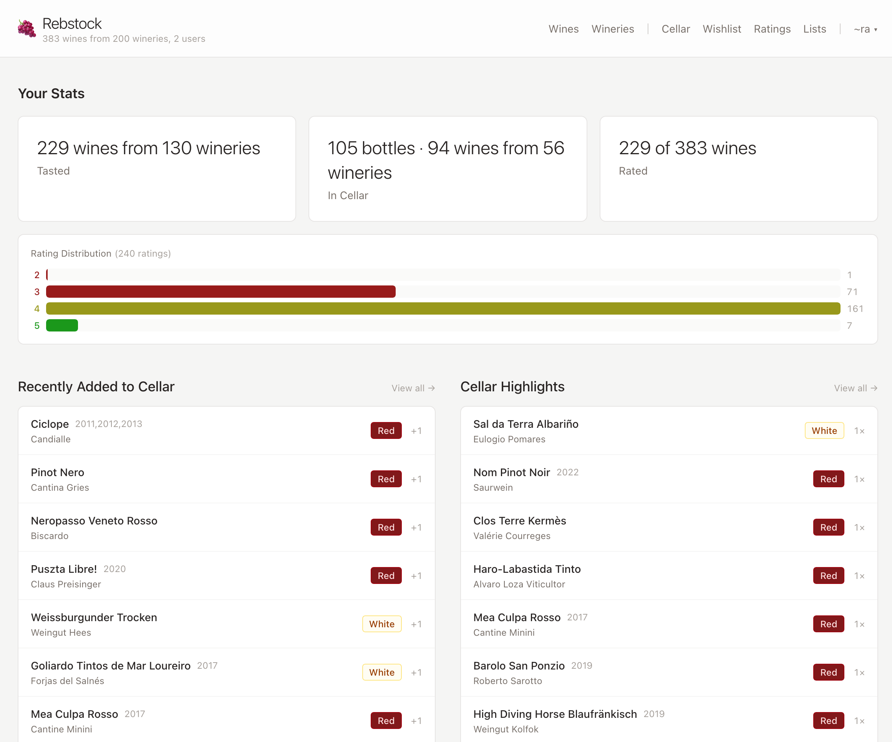
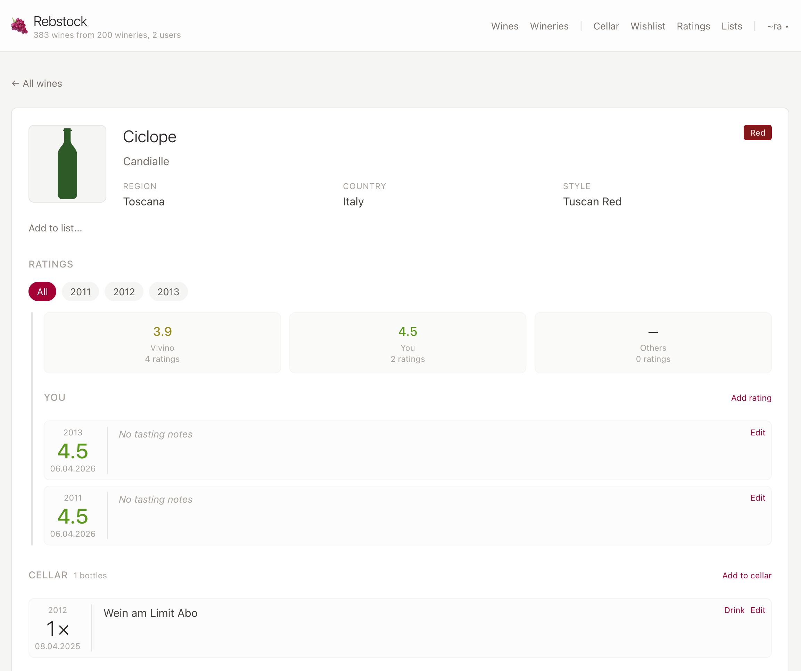
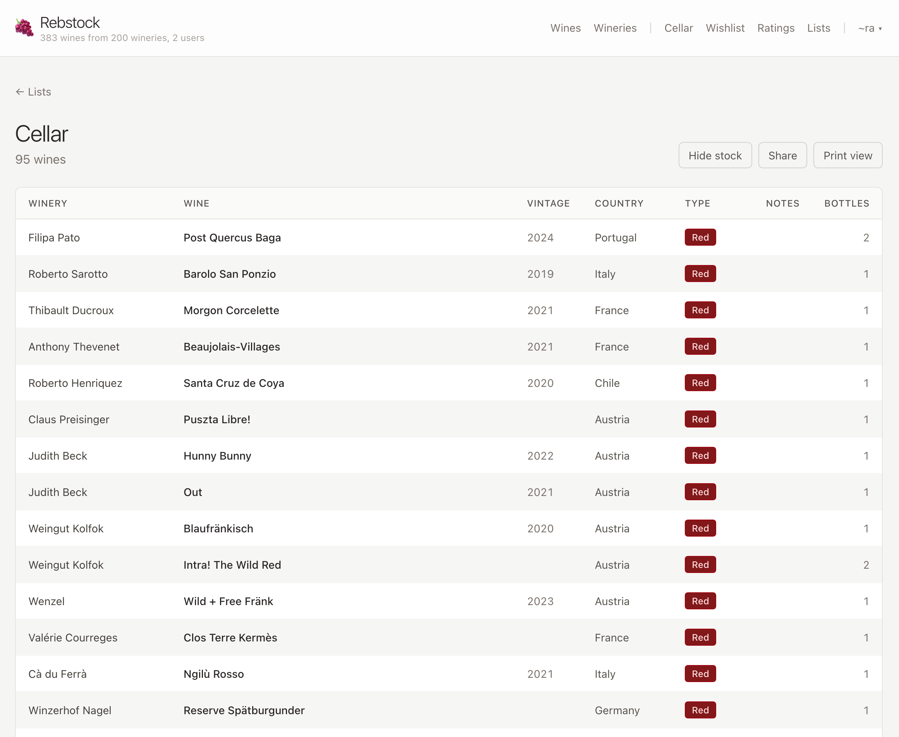
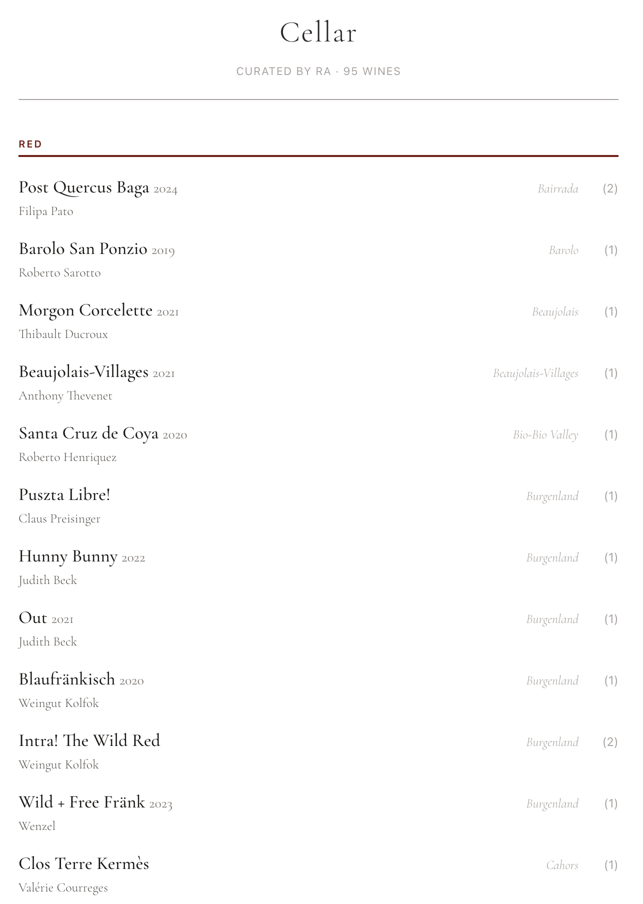

# Rebstock - Self Hosted Wine Inventory

> [!CAUTION]
> This is mostly vibe coded (for now).
> Not that I like it, but I
>
> - want to experiment with agentic coding
> - want to prototype quickly to learn what works for me (and my wines) before I start polishing anything
> - am very curious about [Gleam](https://gleam.run)
> - don't consider UI design one of my "strengths".
>
> Features that stick with my workflow will be cleaned up properly.
> The DB schema is carefully reviewed to provide some stability.

## About

First release of Rebstock, a self-hosted wine cellar management app.

**Features:**

- Wine and winery catalog with cellar tracking, ratings, and wishlist





- Shareable and printable wine lists with bottle counts to check your inventory or suggest wines to friends




    
- MCP tools for agent-assisted imports and Vivino rating refreshes
- Simple auth (single user or forward auth via [reverse proxy](#Authentication))

Rebstock is the German name for (grape)vine.
It also the app to manage the bottles I have in stock 🎉


## Stack

- Gleam with Wisp/Mist
- SQLite
- Tailwind CSS and HTMX
- just as taskrunner
- nix for deployment

## Configuration

See [config.example.json](./config.example.json).
The referenced JSON schema serves as documentation.

For MCP imports, rating refreshes, and Codex browser login through Authelia, see [MCP tools](./docs/mcp.md) and [OAuth setup](./docs/mcp-auth.md).
MCP is disabled by default and authenticates separately from the web interface.

### Authentication

There's no authentication if started in _single_ mode.
Every request will be authenticated automatically as the given user.

```json
"auth": {
  "single": {
    "user": "admin"
  }
}
```

In _forward_ (forward auth) mode, the user is read from configurable headers set by the reverse proxy.
Name, email and groups can also be supplied this way, but are not for now.

```json
"auth": {
  "forward": {
    "header_user": "X-WEBAUTH-USER",
    "header_name": "X-WEBAUTH-NAME",
    "header_email": "X-WEBAUTH-EMAIL",
    "header_groups": "X-WEBAUTH-GROUPS"
  }
}    
```

[Traefik](https://doc.traefik.io/traefik/reference/routing-configuration/http/middlewares/forwardauth/) and [Caddy](https://caddyserver.com/docs/caddyfile/directives/forward_auth) support and document this well.
I use Caddy with [Authelia](https://www.authelia.com/integration/proxies/caddy/).
See [Installation](#Installation) for example snippets from my setup.

> [!CAUTION]
> Read the docs to understand the security implications of _forward auth_ or someone will steal all your bottles.
>
> In forward mode the app trusts the auth headers unconditionally: anyone who can reach the port directly can impersonate any user (and unknown usernames are auto-created). Bind the app to localhost or a private interface, expose it **only** through the reverse proxy, and make sure the proxy strips/overwrites the `X-WEBAUTH-*` headers on incoming requests.

## Installation

### NixOS

There's a [flake.nix](./flake.nix) for installation on nix based systems.

```sh
# build the flake
$ nix build
# get a shell with all dependencies and tools
$ nix develop
```

Example from my dotfiles:

```nix
# flake.nix
{
  inputs = {
    nixpkgs.url = "github:NixOS/nixpkgs/nixos-25.11";
    rebstock = {
      url = "git+ssh://forgejo@git.neonforest.org/ra/rebstock";
      # Don't follow nixpkgs 25.11 — rebstock needs nixpkgs-unstable for a gleam
      # version that supports offline builds with pre-populated packages.toml
      # inputs.nixpkgs.follows = "nixpkgs";
    };
  };
  
  outputs = { self, nixpkgs, rebstock, ... }: {
      nixosConfigurations.workstation = nixpkgs.lib.nixosSystem {
        modules = [
          rebstock.nixosModules.default
          ./modules/rebstock.nix
          # ...
        ];
      };
    };
}

# rebstock.nix
{ ... }:
{
  services.rebstock = {
    enable = true;
    # config.json will be generated from this
    host = "0.0.0.0";
    port = 3000;
    # see matching caddy/authelia config below
    auth = {
      mode = "forward";
      headerUser = "X-WEBAUTH-USER";
      headerName = "X-WEBAUTH-NAME";
      headerEmail = "X-WEBAUTH-EMAIL";
      headerGroups = "X-WEBAUTH-GROUPS";
    };
  };
  networking.firewall.allowedTCPPorts = [ 3000 ];
}
```

```caddy
# Caddy config for Authelia
(idp) {
	forward_auth localhost:9091 {
		uri /api/authz/forward-auth
		copy_headers {
			Remote-User>X-WEBAUTH-USER Remote-Groups>X-WEBAUTH-GROUPS Remote-Email>X-WEBAUTH-EMAIL Remote-Name>X-WEBAUTH-NAME
		}
	}
}
```

```yaml
# Authelia config
access_control:
  rules:
    - domain: 'rebstock.neonforest.org'
      resources:
        - ^\/shared\/.+$
        - ^\/static\/css\/.+$
      methods:
        - GET
      policy: bypass
```

### Build it Yourself

> [!NOTE]
> The NixOS flake is used for CI, so it's a good reference how to build.

If you're not on NixOS, do this instead:

```sh
# clone the repo and cd into it
$ git clone $BASE/rebstock.git
$ cd rebstock
# install just to check what tools are missing and install them
$ just setup-dev
# build the shipment
$ gleam export erlang-shipment
# start with your copy of config.example.json
$ ./build/erlang-shipment/entrypoint.sh run --config /foo/bar/my.config
```

## Development

`just dev` starts the service on [localhost:3000](http://localhost:3000) and seeds an empty database with deterministic demo wines.
Use the MCP tools to import your own export or purchase documents.

`just setup-dev` will check if all dev tools are available and install Git pre-commit format hook.

If you're on nix, `nix develop` will drop you in a dev shell with all development tools present.
